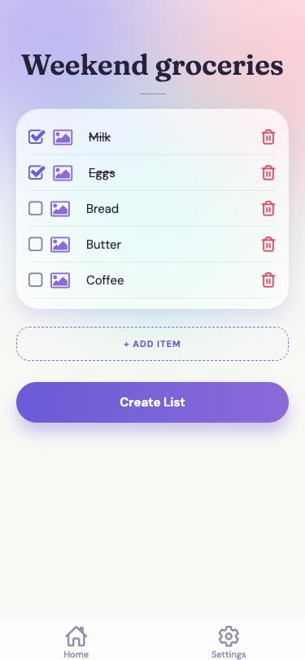
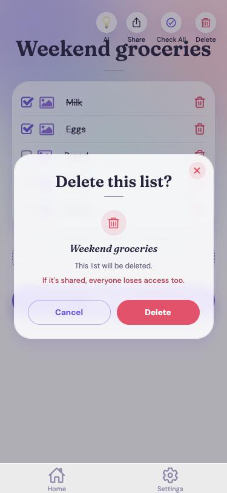
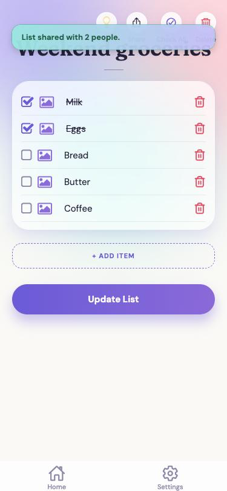
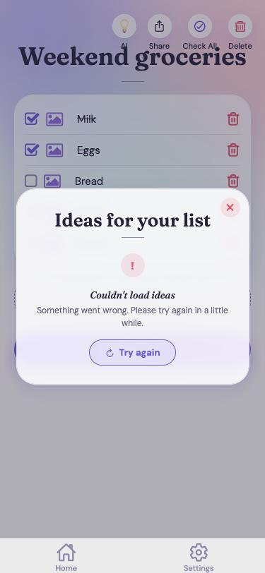
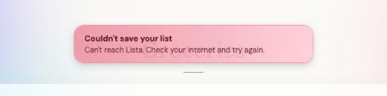
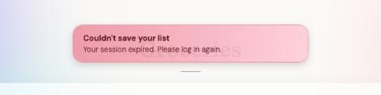

# Welcome to application LISTA - frontend 👋

## **Lista - Personal and Collaborative List Management App**  

The frontend of **Lista**, a personal and collaborative list management app,
is built to deliver seamless, secure, and efficient functionalities.
This is **Lista 2**: a calm, polished list app with sharing, AI ideas and a secure backend behind it.
Below is the detailed README for setting up and contributing to this project.

<p align="center">
  
  
  
  
</p>

---

## **📋 Overview**  
**Lista** is your ultimate solution for organizing and managing personal and shared lists. 
It combines customization options, easy sharing with tailored permissions, AI list suggestions, 
and a calm, user-friendly experience.


  

---


### 🔗 **Backend URL - PythonAnywhere**:  
✨ [Access the backend here!](https://YOUR-USERNAME.pythonanywhere.com) ✨  
*(replace with your PythonAnywhere address after deployment)*


### 🌐 **Frontend URL - Netlify**:  
✨ [Access the frontend here!](https://YOUR-SITE.netlify.app/Login) ✨  
*(replace with your Netlify address after deployment)*

---

## **Table of Contents**
1. [Introduction](#introduction)  
2. [Project Goals](#project-goals)  
3. [Target Audience](#target-audience)  
4. [The Lista Experience](#the-lista-experience)  
5. [Key Features](#key-features)  
6. [Screens](#screens)  
7. [Architecture](#architecture)  
8. [Technological Stack](#-technological-stack)  
9. [Design System](#design-system)  
10. [Messages and Notifications](#messages-and-notifications)  
11. [AI Suggestions](#ai-suggestions)  
12. [Security and Sessions](#security-and-sessions)  
13. [Configuration](#configuration)  
14. [Database Models](#database-models)  
15. [Testing and Reliability](#testing-and-reliability)  
16. [Development Process](#development-process)  
17. [Future Upgrades](#future-upgrades)  
18. [API Endpoints](#api-endpoints)  
19. [Installation and Setup](#-installation-and-setup)  
20. [Deployment](#deployment)  
21. [Project Structure](#project-structure)  
22. [Contributing](#-contributing)  

---

## **Introduction**  
The idea for **Lista** arose from a daily need to organize, manage, and track lists and tasks effortlessly.  
**Lista** provides an all-in-one solution that combines personal and collaborative list management with 
customizable design.  
**Lista 2** is built around the person using it: a clear visual identity, specific feedback after every action, 
safe sharing with real permissions, and a secure, tested backend behind every screen.

---

## **Project Goals**  
- Create an intuitive application for managing lists, compatible with all devices (mobile and desktop).  
- Enable collaboration, editing, and sharing of lists with clear permissions.  
- Provide user-friendly tools for productive and seamless management.  
- Deliver a highly personalized user experience.  
- Give the user clear, specific feedback about what happened and what to do next.  

---

## **Target Audience**  
- **Individuals**: People looking to organize personal lists and tasks.  
- **Groups**: Teams managing projects, events, or activities collaboratively.  
- **Organized Users**: People who need to share and manage information efficiently with tailored permissions.  

---

## **The Lista Experience**  

Lista is designed to feel like *a quiet place to keep what matters*. A list should take seconds to make, 
and nothing in the app should make you wonder what just happened.

### 🎨 A Calm, Consistent Look
- **Aurora Glass design system**: soft violet, coral and teal gradients, frosted-glass cards, **Fraunces** headings and **DM Sans** body text. 
- **One visual language everywhere**: every page and every pop-up uses the same masthead-style title with a thin rule underneath, 
  the same rounded cards and the same gradient buttons.
- **Your own background**: choose a photo, a gradient or your own picture in Settings, and it applies to every screen.
- **Gentle loading**: a three-dot *Aurora Dots* animation instead of a blank screen.

### 🧭 Easy to Understand at a Glance
- **Home shows progress, not paperwork**: each list is a card with a progress badge (`2/5`) and a colored bar, so you see what is done without opening anything.
- **Few buttons, clear icons**: AI, Share, Check All and Delete sit in one row above the list; everything else is on the page itself.
- **Checked items look checked**: struck through, with no raw symbols.

### 💬 Clear Feedback After Every Action
- Every success and every problem ends with a **short, specific message** that says what happened and, when possible, what to do next 
  (see [Messages and Notifications](#messages-and-notifications)).
- **Risky actions ask first**: deleting a list shows a confirmation that also warns when the list is shared.
- **Forms explain themselves**: a weak password gets a plain sentence such as *"This password is too short. It must contain at least 8 characters."*

### 🔒 Comfortable and Safe
- The login renews itself quietly, so you are not thrown out in the middle of a list.
- Deleted lists are only hidden, never erased from the database.
- Other people can see or change a list only if you shared it with them, with the permission you chose.

---

## **Key Features**  

### Available in Lista 2
1. **List Management**  
   - Create and manage lists (shopping, tasks, travel and more).  
   - Add items with optional images.  
   - Mark items as complete, or **Check All / Uncheck All** at once.  
   - **Update Lists**: add or remove items, or change the title (a title is required, with a clear message if it is missing).  
   - **Delete Lists**: with a confirmation. Lists are hidden, not erased, so nothing is lost permanently.  
   - A progress badge and bar on every list card.

   | Create a list | Edit a list | Delete confirmation |
   |:-------------:|:-----------:|:-------------------:|
   |  |  |  |

2. **List Sharing**  
   - Share lists with others via email, **several people at once**.  
   - Choose user permissions per person:  
     - **Read-Only** (can view)  
     - **Full Access** (can edit and share onward)  
   - People are grouped by what they can do (*Can view* / *Can edit*) and can be moved between groups before you confirm.  
   - People who are not on Lista yet get a clear message to join first. Everyone who could be shared with is saved; the rest stay in the box with an explanation.  
   - The permission is enforced by the server, not only hidden in the app.

   | Confirmation after sharing |
   |:--------------------------:|
   |  |

   *The share box itself is shown at the top of this page.*

3. **Customization**  
   - Personalized backgrounds applied to the whole app: photos, gradients, or your own picture.  

4. **AI Suggestions**  
   - Ask for ideas based on your current list. The suggestions come from Google Gemini through a Netlify function, 
   so the key is never exposed to the app. See [AI Suggestions](#ai-suggestions).  

5. **User-Friendly Interface**  
   - Clean, calm design suitable for all user types, with short, specific messages after every action.  

6. **Security and User Management**  
   - Secure registration and login with **JWT**, with automatic renewal of expired sessions.  
   - Permission-based management by user and list.  
   - Password strength rules and a single-use, expiring password-reset link sent by email.  
   - A private profile: Edit Profile shows and changes only your own details.

   | Register with a weak password |
   |:-----------------------------:|
   |  |

7. **Device Compatibility**  
   - A responsive web app built mobile-first, checked at phone width and in a desktop browser.  
   - Ships with a web manifest, favicon set and Apple touch icon, so it has its own icon and theme color when added to a home screen.

### Planned (not yet available)
These are on the roadmap (see [Future Upgrades](#future-upgrades)); they are **not** implemented yet:
- Categories and deadlines for tasks and lists.  
- Real-time updates for everyone connected to a shared list.  
- Notifications about changes to shared lists.  
- Restoring deleted lists.  
- Personalized notifications powered by AI.

---

## **Screens**  

*Screenshots appear once: Login, Home, Share and Settings at the top of this page, and the list, delete, register and AI screens with their features.*


1. **Login and Register**  
   - Registration with just a username, an email address and a password that meets the strength rules (no first or last name is asked for).
   - Login for existing users with username and password, with a show/hide password toggle.  
   - **Forgot password** and **Change password** screens that work with the emailed reset link.  

2. **List Overview (Home)**  
   - View all lists (personal and shared) as cards with a progress badge and bar.  
   - Create new lists with the round **+** button.  

3. **List Creation and Editing**  
   - Add items, mark them as done, attach images, and **Check All / Uncheck All**.  
   - Icons for **AI suggestions**, **Share**, **Check All** and **Delete**.  

4. **Share, AI and Delete boxes**  
   - Share with several people and set permissions, ask the AI for ideas, or delete with a confirmation.  

   | AI suggestions |
   |:--------------:|
   |  |

   *The AI screenshot shows the "Couldn't load ideas" state with **Try again**.*

5. **Settings**  
   - Support contact, **Edit Profile**, and the background gallery.  

---

## **Architecture**  


Lista is split into three parts that each do one job:

| Part | Where it runs | What it does |
|------|---------------|--------------|
| **Frontend** (this repository) | Netlify (static site) | Every screen, the design system, session renewal and error messages |
| **Backend API** (separate repository) | PythonAnywhere | Accounts, lists, sharing and permissions, images, backgrounds, password reset |
| **AI function** (`netlify/functions/recommendations.js`) | Netlify (serverless) | Asks Google Gemini for list ideas; keeps the key out of the app |

**How the pieces talk**
- The app calls the backend over HTTPS with **Axios**, sending `Authorization: Bearer <token>` on protected requests. One shared address (`constants/config.ts`) is used everywhere.
- When the short-lived access token expires, a single response interceptor (`utils/authSession.ts`) renews it with the refresh token and repeats the request.
- The backend sends password-reset emails through **Brevo**; the email contains a link back to this site.
- The AI box calls the Netlify function, which calls Google Gemini. The Gemini key lives only in Netlify's environment.

---

## **🚀 Technological Stack**

| Domain         | Technology                                                                        |
|----------------|-----------------------------------------------------------------------------------|
| Frontend       | React Native (TypeScript), Expo SDK 51, React Navigation                          |
| Hosting (web)  | **Netlify** (static site + serverless function)                                   |
| Backend        | Django REST Framework, CORS (see the backend README)                              |
| Hosting (API)  | **PythonAnywhere**                                                                |
| Database       | SQLite (persistent disk on PythonAnywhere)                                        |
| Security       | JWT Authentication with refresh tokens                                            |
| Email          | **Brevo** web API (password-reset emails)                                         |
| AI Integration | **Google Gemini** through a Netlify serverless function                           |
| Typography     | Fraunces (headings) and DM Sans (text) via Expo Google Fonts                      |
| Code Quality   | TypeScript on the frontend; Pylint with PEP8 compliance and autopep8 on the backend |

---

- **Frontend**: React Native with TypeScript, powered by **Expo** for streamlined project management and development.  
- **Backend**: Django REST Framework, with CORS support to ensure smooth cross-origin communication.  
- **Database**: SQLite for lightweight and efficient data storage.  
- **Security**: Authentication and permission management using **JWT (JSON Web Tokens)**.  
- **Communication**: **Axios** facilitates seamless HTTP requests between the frontend and backend.   
- **Notifications**: `react-native-toast-message` with custom gradient toast cards.  
- **Code Quality**: TypeScript on the frontend. On the backend, static analysis with **Pylint** and **PEP8** formatting via **autopep8**.  
- **Logging**: Robust debugging and auditing capabilities via **Python's logging module** on the backend.  

---

## **Design System**  

Lista uses a small, consistent design system so every screen feels like one product.

- **Theme tokens** (`constants/theme.ts`): colors, fonts, radii and shadows used everywhere.  
- **Aurora palette**: violet `#6A5BD6`, coral `#FF9EB0`, teal `#5FD9CE` on a warm off-white background.  
- **Components** (`components/`):  
  - `GlassCard` - frosted glass surfaces for cards and boxes.  
  - `PrimaryButton` - gradient button with loading and disabled states.  
  - `AuroraBackground` / `AppBackground` - the soft gradient backdrop and the user's chosen background.  
  - `AuroraDotsLoader` - the three-dot loading animation.  
  - `ToastConfig` - custom gradient "wash" cards for success and error toasts.  
- **Masthead style**: a serif title with a short rule underneath, used on every page and every pop-up box.  

---

## **Messages and Notifications**  

Every action ends with a short toast that says what happened and, when possible, what to do next.

| Situation | Message |
|-----------|---------|
| List saved / updated / deleted | "Your list was saved." / "...updated." / "...deleted." |
| Several people shared | "List shared with 2 people." |
| Missing title | "Add a title to save your list." |
| No internet or server asleep | "Couldn't save your list" - "Can't reach Lista. Check your internet and try again." |
| Session expired | "Your session expired. Please log in again." |
| No permission | "You don't have permission to do that." |
| Server problem | "Lista's server had a problem. Try again in a moment." |
| Someone not on Lista | "Couldn't find: name@example.com. They need to join Lista first, then share again." |

The wording comes from one helper, `utils/describeError.ts`, so every screen explains problems the same way. 
The password-changed message is *"Password changed. Log in with your new one."*

| Success | Error |
|:-------:|:-----:|
|  |  |
|  |  |

---

## **AI Suggestions**  

From a list's page, the lightbulb icon opens **Ideas for your list**: five short, related items you might want to add.

- **Four clear states**: *Thinking* (loading dots), *Ideas*, *No ideas this time*, and *Couldn't load ideas* with a **Try again** button.  
- **How it works**: the app sends the list's items to the Netlify function `recommendations.js`, which asks **Google Gemini** and returns the suggestions. 
  The function is the only place that holds the Gemini key, so it never reaches the app or the repository.  
- **Setup**: add `GEMINI_API_KEY` in Netlify's environment variables. The model can be changed without touching code with `GEMINI_MODEL` 
  (default `gemini-3.5-flash-lite`), because Google retires models from time to time.  
- **Without a key**, or when Gemini is unreachable, the box shows *Couldn't load ideas* and **Try again**, and the rest of the app is unaffected.  

*Note: the function does not ask the visitor to log in, so on a public site anyone who knows its address could use your Gemini quota. 
Keep an eye on usage in Google AI Studio.*

---

## **Security and Sessions**  

- **Tokens**: the backend issues a short-lived **access token** (about 25 minutes) and a long-lived **refresh token** (90 days). 
  Both are kept in the device's `AsyncStorage` and removed when you log out.  
- **Automatic renewal** (`utils/authSession.ts`): when a request fails because the access token expired, the app exchanges 
  the refresh token for a new one and repeats the request. Several requests that expire together share one renewal. 
  If renewal is impossible, the app returns to the Login screen.  
- **Private data**: Edit Profile sends the login token and only shows and changes the signed-in user's own profile.  
- **Password reset**: the emailed link contains a **single-use token** that expires after one hour; the Change Password 
  screen sends it and shows a clear message if the link is incomplete, wrong or expired.  
- **AI key**: the Gemini key lives only in Netlify's environment, never in the app.  
- **No secrets in the repository**: the app only contains the public backend address.

---

## **Configuration**  

| Setting | Where | Purpose |
|---------|-------|---------|
| `EXPO_PUBLIC_API_URL` | `.env.local` locally, Netlify environment variables online | Address of the Lista backend. If unset, the default in `constants/config.ts` is used |
| `GEMINI_API_KEY` | Netlify environment variables | Google Gemini key used by the AI function |
| `GEMINI_MODEL` | Netlify environment variables (optional) | Gemini model to use. Default: `gemini-3.5-flash-lite` |

**Why one setting?** The backend address is defined once in `constants/config.ts` and every screen imports it, 
so moving to a new server means changing one value, with no code edits. 
Copy `.env.example` to `.env.local` to try it locally, for example `EXPO_PUBLIC_API_URL=http://localhost:8000`.

---

## **Database Models**  

The models live in the backend (see the backend README); they are listed here for reference.

### **Users**  
Utilizes Django’s built-in `User` model:  
- **User ID**: Unique identifier.  
- **Username**: Unique within the system, used for login alongside the password
- **First and last name**: optional. The app no longer asks for them, so new accounts have them empty; they are kept for existing accounts and for older app versions that still send them.  
- **Email**: Unique within the system, used for sharing lists and password recovery.  
- **Password**: Secure authentication credential (stored hashed; must meet the strength rules).  

### **ListItem**  
Represents tasks or list items:  
- **List ID**: Unique identifier for the list.  
- **Title**: Default: `"No items"`.  
- **Items**: Stored as plain text, separated by `|`. Checked items start with `✔️ `.  
- **Creation Date**: Auto-generated upon list creation.  
- **Owner**: Associated with the user who created it.  
- **Status**: Active or inactive. Deleting a list in the app sets it to inactive; the data stays in the database.  

### **GroupList**  
Manages collaborative list sharing:  
- **User**: Reference to a participating user.  
- **List**: Reference to the shared list.  
- **Join Date**: Date user joined the group.  
- **Role**: Either `Admin` or `Member`.  
- **Permissions**: `Read-Only` or `Full Access`.  

### **ListItemImage**  
Stores images associated with a specific list item and index:
- **List Item:**: A foreign key linking to the ListItem model
 (on_delete=models.CASCADE, related_name='images').
- **Image:**: An image file, optional (default='/placeholder.png', 
upload_to='list_item_images/').
- **Index:**: Position of the image in the list, defaults to 0.
- **MIME Type:**: Optional field to store the image's MIME type 
(max_length=50)

### **Customization**  
Allows users to personalize their experience:  
- **User**: Reference to the modifying user.  
- **Background**: Identifier for a custom background image.  

> AI suggestions are not stored: they are generated on request by the Netlify function and shown straight away.

---

## **Testing and Reliability**  

- **Backend**: **73 automated tests** replay the app's real requests (same URLs, bodies and headers) and cover registration, login and token renewal, 
  list permissions, sharing, images, backgrounds, profiles, password rules, password reset and log safety. See the backend README.  
- **Frontend**: the screens and their error cases were checked in a browser, including no internet, an expired session, a refused request, 
  a missing list title, sharing with someone who is not on Lista, and a weak password.  
- **Predictable errors**: every failure is turned into one short sentence by `utils/describeError.ts`; no screen shows a raw error code.  
- **Resilient sessions**: an expired access token is renewed once, shared between simultaneous requests, and sends you back to Login only if renewal is impossible.  
- **Graceful AI failures**: if Gemini cannot be reached the AI box says so and offers **Try again**; the list itself is never affected.  
- **Known type errors**: `npx tsc --noEmit` currently reports a few type errors. They do not stop the app from building or running, and are on the cleanup list.

---

## **Development Process**  
1. **Planning and Design**  
   - Market research, wireframes, and user interface design.  
   - The Aurora Glass design system was designed as mock-ups and approved screen by screen before it was built.  

2. **Frontend Development**  
   - Built with React Native and Expo.  

3. **Backend Development**  
   - Developed using Django for API, authentication, and security.  

4. **Integration**  
   - Seamless data exchange using Axios.  

5. **Quality Assurance (QA)**  
   - Manual and automated feature testing.  
   - The backend has **73 automated tests**; the frontend screens were checked in a browser, including the error cases above.  

6. **Release and Feedback**  
   - Release followed by user feedback for continuous improvement.  

7. **Development Process**  
    Responsive Design Implementation
   - Developed a mobile-first approach using modern CSS techniques and frameworks.
   - Checked at phone width and in a desktop browser to keep the layout and functionality consistent.

---
## **Future Upgrades**  
- Integration with external apps.  
- Add a list to a calendar with a reminder (a one-tap "Add to calendar" button is the first step).  
- Restore deleted lists ("Undo" after deleting and a "Recently deleted" screen).  
- Categories, deadlines, notifications and real-time updates for shared lists.  
- Performance analytics and productivity tracking.  
- Personalized notifications powered by AI.  

---

## **API Endpoints**  

The full, authoritative reference is in the **backend README**. These are the calls the frontend makes. 
Protected endpoints need the header `Authorization: Bearer <access token>`.

### User Authentication  
#### Register  
- **URL:** `/register/`  
- **Method:** `POST`  
- **Body Example:**  
  ```json
  {
    "username": "user1",
    "email": "user1@example.com",
    "password": "a-strong-password-42"
  }
  ```
- **Response (201):** `{ "Success": "New user created", "username": "user1", "user_id": 1, "access": "...", "refresh": "..." }`
- **Note:** `first_name` and `last_name` are optional; the app no longer sends them.

#### Login  
- **URL:** `/login/`  
- **Method:** `POST`  
- **Body Example:**  
  ```json
  {
    "username": "user1",
    "password": "a-strong-password-42"
  }
  ```
- **Response (200):** `{ "access": "...", "refresh": "..." }`

#### Renew the session  
- **URL:** `/token/refresh/`  
- **Method:** `POST`  
- **Body:** `{ "refresh": "..." }`  
- **Response (200):** `{ "access": "...", "refresh": "..." }` (the refresh token is replaced each time)

#### Lists of the current user (Home)
- **URL:** `/grouplists/by-user/{user_id}/`  
- **Method:** `GET`  
- **Response:**  
  ```json
  [
    {
      "id": 1,
      "title": "Weekend groceries",
      "items": "✔️ Milk|✔️ Eggs|Bread|Butter|Coffee",
      "date_created": "2026-10-06",
      "user": 2,
      "is_active": true
    }
  ]
  ```  

#### Create a list
- **URL:** `/listitem/` then `/grouplists/`  
- **Method:** `POST`  
- **Body:** `{ "title": "...", "items": "Milk|Eggs", "user": 2, "is_active": true }`, then 
  `{ "user": 2, "list_item": 1, "role": "admin", "permission_type": "full_access" }`

####  **Delete ListItem (Deactivate List)**

- **URL:** `/listitem/{id}/`
- **Method:** `PATCH`
- **Body:** `{ "is_active": false }`
- **Description:** Deactivates a list item instead of deleting it. The app asks for confirmation first.

#### **Update ListItem**

- **URL:** `/listitem/{id}/`
- **Method:** `PATCH`
- **Description:** Updates an existing list item (needs ownership or full access).
- **Request Body:**
  ```json
  {
    "title": "Updated Shopping List",
    "items": "Apples|Bananas"
  }
  ```

####  **Share List with User by Email**

- **Steps:** 1) `GET /get_user_info/{email}/` returns the person's `id` (404 means they are not on Lista yet). 
  2) `POST /grouplists/` with the person's `id`.
- **Request Body (step 2):**
  ```json
  {
    "user": 5,
    "list_item": 1,
    "role": "member",
    "permission_type": "read_only"  // or "full_access"
  }
  ```
- **Response (201):**
  ```json
  {
    "message": "GroupList created successfully",
    "data": { "id": 7, "user": 5, "list_item": 1, "role": "member", "permission_type": "read_only" }
  }
  ```

### Workflow

1. **Share a List by Email:**
   - The user enters one or more emails and picks the permission for each (`Read Only` or `Full Access`).
   - For each email the app looks the person up, then saves the share. Everyone who could be shared with is saved; 
     the others stay in the box with a message explaining what to do.
   
2. **Get Shared Lists:**
   - When the shared user opens Home, shared lists appear with their other lists; the permission decides whether they can edit.

3. **Delete and Restore:**
   - A deleted list is only hidden (`is_active: false`), so it can be restored in a future version without losing data.

 * This allows flexibility in how lists are shared and managed between users while allowing the user to set different levels of permissions.


---
   
### 🚀 Installation and Setup  
Follow these steps to run the frontend locally:  

1. Clone the repository:  
   ```bash
   git clone https://github.com/YOUR-USERNAME/lista-frontend.git
   cd lista-frontend
   ```
2. Install dependencies (Node.js 20 recommended):  
   ```bash
   npm install
   ```
3. Point the app at a backend (optional). Copy `.env.example` to `.env.local` and set, for example:  
   ```bash
   EXPO_PUBLIC_API_URL=http://localhost:8000
   ```
   Without it the app uses the default address in `constants/config.ts`.
4. Start the app:  
   ```bash
   npm run web        # in the browser
   npx expo start     # Expo menu (web, Android, iOS)
   ```

> The AI suggestions use a Netlify function, so they only work on the deployed site (or with `netlify dev`). 
> Locally the AI box shows *"Couldn't load ideas"*, which is expected.

---

## **Deployment**  

The frontend is a static site built by Expo and hosted on **Netlify**; the backend runs on **PythonAnywhere**.

1. **Deploy the backend first** and note its address (see the backend README).  
2. In Netlify choose **Add new site > Import an existing project** and select this repository. 
   `netlify.toml` already sets the build command (`npx expo export -p web`), the publish folder (`dist`), 
   Node 20, and the rules that make page reloads and the password-reset link work.  
3. Under **Site configuration > Environment variables** add:  
   - `EXPO_PUBLIC_API_URL` = your backend address, e.g. `https://yourname.pythonanywhere.com`  
   - `GEMINI_API_KEY` = a key from Google AI Studio  
   - `GEMINI_MODEL` (optional) = a current Gemini model name  
4. **Deploy** (variables are read at build time, so deploy again after changing them).  
5. Copy your Netlify address into the backend's `CORS_ALLOWED_ORIGINS` and `FRONTEND_URL` settings.  
6. Test: register, create a list, share it, ask for AI ideas, and request a password reset.

**Why this split?** Netlify serves the static site and the serverless AI function (both fit its free plan) and keeps the Gemini key out of the app. 
PythonAnywhere runs the Django API with a persistent disk for the SQLite database and uploaded images. 
Each part can be redeployed on its own.

---

## **Project Structure**  

```
app/                 screens (Login, Register, Home, ListItemDetails, Settings, ...)
components/          GlassCard, PrimaryButton, AuroraBackground, AuroraDotsLoader, ToastConfig, ...
constants/           theme.ts (design tokens), config.ts (backend address), backgrounds
utils/               authSession.ts (session renewal), describeError.ts (error messages)
public/              icons, web manifest and the web page template
netlify/functions/   recommendations.js (AI suggestions with Gemini)
netlify.toml         Netlify build and redirect settings
assets/              fonts, images and app icons
docs/                screenshots and the architecture diagram used in this README
```

---

### 🤝 Contributing  
Contributions are welcome!  
1. Fork the repository.  
2. Create a feature branch: `git checkout -b feature-name`.  
3. Commit your changes: `git commit -m 'Add feature'`.  
4. Push to the branch: `git push origin feature-name`.  
5. Open a pull request.  

---


1. **Fork the repository** to your GitHub account.  
2. **Clone your fork**:  
   ```bash
   git clone https://github.com/yourusername/lista-frontend.git
   ```  
3. Create a new branch:  
   ```bash
   git checkout -b feature/your-feature-name
   ```  
4. Commit changes:  
   ```bash
   git commit -m "Add your feature"
   ```  
5. Push changes:  
   ```bash
   git push origin feature/your-feature-name
   ```  
6. Open a **pull request** in the original repository.  

---

**Thank you for exploring Lista and its frontend! We’re excited 
to see how you use 
and improve it. 😊.** 

**We’re here to make your life easier and more organized.** 😊  


*For improvements, suggestions, and constructive feedback,
I am always happy to hear from you. Enjoy and good luck!*

---

### **Contact Us**
For technical issues or inquiries, please contact:  
📧 **listaassistance@gmail.com**  or  📧 **coralingber@gmail.com**  

---
