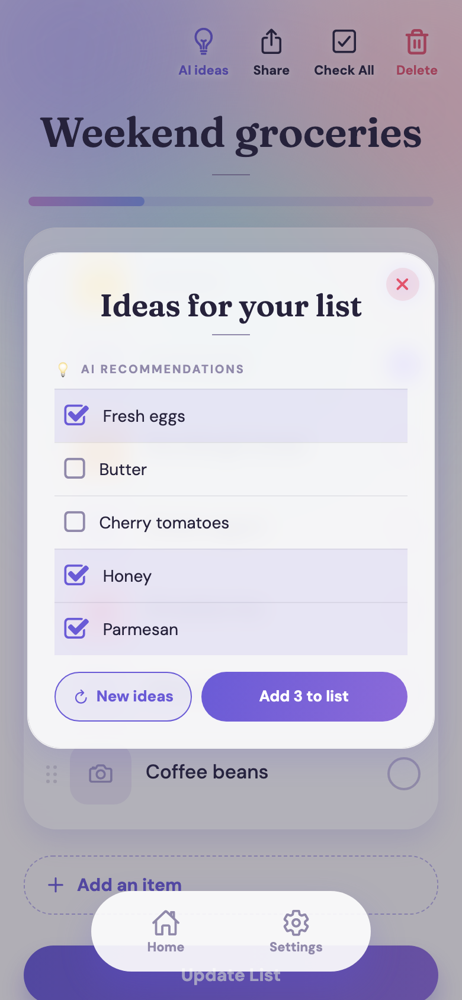
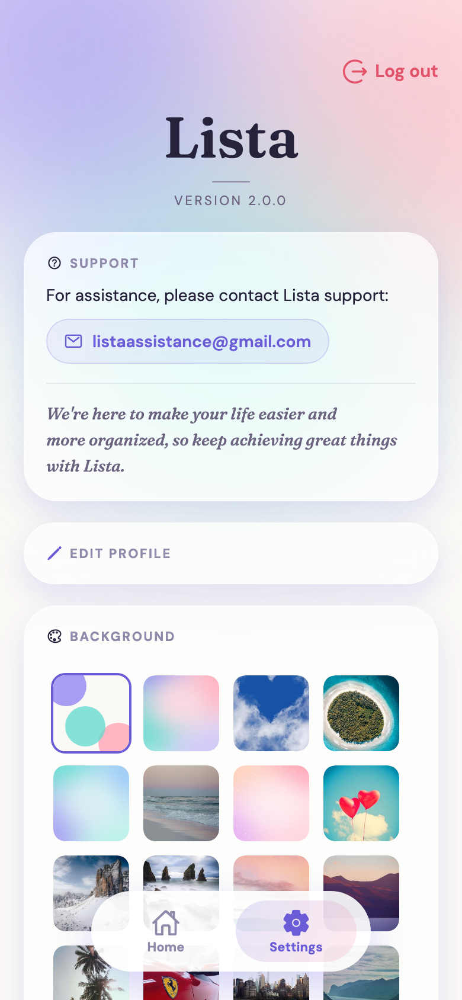

<p align="center">
  
</p>

<p align="center">
  <b>Create, save, organize and share your lists</b>, with pictures, AI ideas and a background that is yours.
</p>

<p align="center">
  <a href="https://listaa2.netlify.app/Login"><b>▶ Open Lista</b></a> &nbsp;·&nbsp;
  <a href="docs/features.md#lista-1-compared-with-lista-2">What's new</a> &nbsp;·&nbsp;
  <a href="docs/architecture.md">How it works</a> &nbsp;·&nbsp;
  <a href="https://github.com/coralingberlandau/lista2_backend">Backend</a>
</p>

<p align="center">
  
  
  
  
</p>

<p align="center">
  
  
  
  
  
</p>

---

## ✨ Why Lista

<table>
<tr>
<td width="33%" valign="top">

### ✍️ Create, save, reuse
A list takes seconds. Come back to it any time, uncheck everything and use it again.

</td>
<td width="33%" valign="top">

### 🗂️ Organize
Tick items off, swipe a row to delete it (with Undo), drag rows into order, add pictures, and watch the progress bar.

</td>
<td width="33%" valign="top">

### 🤝 Share safely
Read-Only or Full Access per person, enforced by the server.

</td>
</tr>
<tr>
<td valign="top">

### 💡 Never out of ideas
Five AI suggestions: tick the ones you like and add them in one tap.

</td>
<td valign="top">

### 🎨 Make it yours
Photos, gradients or your own picture as the background, on every page after you log in.

</td>
<td valign="top">

### 📱 Everywhere
Phone, tablet and desktop. Add it to your home screen.

</td>
</tr>
</table>

---

## 🧭 Features at a Glance

**Legend:** ✅ already in Lista 1 &nbsp;·&nbsp; ⬆️ in Lista 1 and improved in Lista 2 &nbsp;·&nbsp; 🆕 new in Lista 2 &nbsp;·&nbsp; 🔁 changed in Lista 2

| | Feature | Status | In short |
|:-:|---|:-:|---|
| ✍️ | **Create and save lists** | ✅ | A title and as many items as you like, saved to your account. A long title continues on the next line instead of being cut off |
| ☑️ | **Tick items off** | ✅ | Mark items as done |
| ☑️ | **Check All / Uncheck All** | 🆕 | Tick or clear a whole list in one tap, so a list is easy to reuse |
| 🏠 | **Home with your lists** | 🔁 | Your lists and a "Hello, <username>" greeting. Logout now lives in Settings only |
| 📊 | **Progress on every list** | 🆕 | A badge (`2/7`) and a colored bar on each Home card, and a progress bar at the top of every list |
| 🗑️ | **Update and delete lists** | ⬆️ | Deleted lists are only hidden. Now Lista asks first and warns when the list is shared. Deleting one item is a swipe, with Undo |
| 🖼️ | **Pictures on any row** | ⬆️ | Attach a picture and open it. Now with swipe, replace and remove, safe all-or-nothing saving, and photos shrunk before upload |
| ↕️ | **Drag rows into order** | 🆕 | A faint six-dot handle; the row's picture moves with it. Press Enter to add a row |
| 👈 | **Swipe a row to delete it, with Undo** | 🆕 | Swipe left and tap Delete; "Item deleted · Undo" brings it back, with its picture, for 5 seconds. On a computer: trackpad swipe or the trash that appears on hover |
| ⏳ | **A page appears only when it is ready** | 🆕 | Three dots from the very first moment the app opens and on every page while it loads (only if the wait is noticeable), then the complete page at once, pictures included; if it cannot load, a clear message and Try again |
| 🤝 | **Share with permissions** | ⬆️ | Read-Only or Full Access. Now several people at once, grouped by permission, enforced by the server, with truly view-only lists |
| 💡 | **AI ideas** | ⬆️ | Suggestions for your list. Now from Google Gemini, with tick-and-add, "New ideas" and friendly error states |
| 🎨 | **Backgrounds** | ⬆️ | Photos saved per person. Now also gradients and your own picture, on every page after you log in and scaled to any screen. A newly chosen background reaches every screen at the same moment and replaces the old one only once it has fully loaded |
| 🚪 | **Opening the app** | ⬆️ | Lista 1 opened on a Welcome page that asked people to wait for the free-tier server to wake up before using the app. Lista 2 opens straight on Login |
| 👤 | **Sign-up and login** | ⬆️ | Sign up with just a username, an email and a password, and log in with either your username or your email address; every form uses the same short, plain field labels; the session renews automatically |
| 🔑 | **Password reset by email** | ⬆️ | Now a single-use link that expires after one hour |
| ⚙️ | **Edit profile and Settings** | ⬆️ | Username and email only, and your profile is private. Settings keeps the support contact (now a tidier card with a tappable email), a clearly labelled **Log out** button in the top right corner, and on large screens stays in one centered column |
| 📱 | **Phone, tablet and desktop** | ⬆️ | Adapts to every size, including landscape and iPhone, and can be added to the home screen with its own icon |
| 💬 | **Messages after every action** | ⬆️ | Short, specific messages that say what happened and what to do next |
| 🫙 | **Empty-list messages** | 🆕 | A friendly "No items yet" on Home, in the list and in the AI box |
| ✨ | **Look and feel** | 🆕 | A complete redesign: soft gradients, frosted-glass cards, photo-first rows and a floating bottom bar. Titles in Hebrew are as bold as titles in English |

More detail, including everything Lista 1 offered, is in the [feature guide](docs/features.md).

---

## 🆕 What's New in Lista 2

Lista 1 already offered lists, pictures, sharing, backgrounds, AI ideas and password reset. Lista 2 keeps all of that and:

- gives the whole app a **complete redesign**: photo-first rows, a floating bottom bar and progress on every list
- adds **drag-to-reorder**, **swipe to delete with Undo**, **Check All / Uncheck All** and friendly empty-list messages
- shows **only the three dots until a page is ready**, then the complete page (and Try again if it cannot load)
- makes pictures **safer and easier** (viewer, all-or-nothing saving)
- lets you **share with several people at once** and keeps view-only lists truly view-only
- moves AI ideas to **Google Gemini** and lets you tick and add them
- opens **straight on Login** instead of a Welcome page that asked people to wait for the free-tier server to wake up
- simplifies sign-up to **username, email and password**, and strengthens accounts

The [full comparison](docs/features.md#lista-1-compared-with-lista-2) lists every difference.

---

## 👥 About Lista

**Goals:** an intuitive app for managing lists on every device; collaboration with clear permissions; productive, seamless tools; a personalized experience; and clear feedback after every action.  
**Made for:** individuals who want to organize personal lists, groups managing projects or events together, and anyone who needs to share information with tailored permissions. [Read more](docs/about.md).

---

## 📚 Documentation

| | Page | What you will find |
|:-:|---|---|
| 🧭 | [Features](docs/features.md) | Every feature, what came from Lista 1 and what is new |
| 🏗️ | [Architecture](docs/architecture.md) | The three parts, the technology and the project structure |
| 💡 | [AI ideas](docs/ai-ideas.md) | How the suggestions work and how to set them up |
| 🔐 | [Security and sessions](docs/security.md) | Logins, sessions and password reset |
| 🎨 | [Design and messages](docs/design-and-messages.md) | The look of Lista, its design system and its messages |
| 🔌 | [API calls](docs/api-calls.md) | The calls the app makes to the backend |
| ⚙️ | [Configuration](docs/configuration.md) | The settings you can change |
| 🧪 | [Testing and process](docs/testing-and-process.md) | What is tested and how Lista is built |
| 🚀 | [Getting started](docs/getting-started.md) | Run it on your computer and deploy it |
| 🗺️ | [Roadmap](docs/roadmap.md) | What is planned |

---

## 🚀 Quick Start

```bash
npm install
npm run web
```

Point the app at a backend by copying `.env.example` to `.env.local` and setting `EXPO_PUBLIC_API_URL`. See [Getting started](docs/getting-started.md).

## 🤝 Contributing

Fork, create a branch (`feature/your-feature-name`), make your change with a **clear commit message that says what changed and why**, and open a pull request.

<div align="center">

---

**Frontend** · [Backend repository](https://github.com/coralingberlandau/lista2_backend) · [Live app](https://listaa2.netlify.app/Login)  
Backend API: `https://coral8.pythonanywhere.com`  
📧 Questions or feedback: **listaassistance@gmail.com**

*Thank you for exploring Lista. We hope it makes your life easier and more organized.* 😊

</div>
