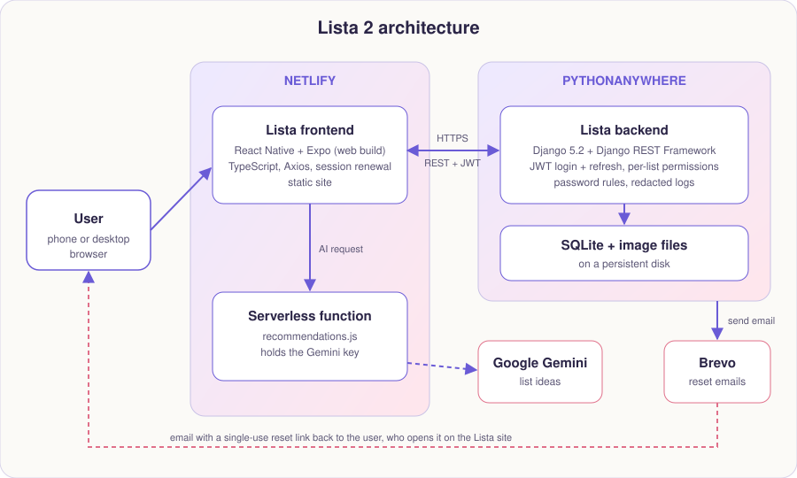

[← Back to the README](../README.md)

# Architecture, Technology and Project Structure



Lista is split into three parts that each do one job:

| Part | Where it runs | What it does |
|------|---------------|--------------|
| **Frontend** (this repository) | Netlify (static site) | Every screen, the design system, session renewal and error messages |
| **Backend API** (separate repository) | PythonAnywhere | Accounts, lists, sharing and permissions, images, backgrounds, password reset |
| **AI function** (`netlify/functions/recommendations.js`) | Netlify (serverless) | Asks Google Gemini for list ideas; keeps the key out of the app |

**How the pieces talk**
- The app calls the backend over HTTPS with **Axios**, sending `Authorization: Bearer <token>` on protected requests. One shared address (`constants/config.ts`) is used everywhere.
- When the short-lived access token expires, the app renews it with the refresh token and repeats the request.
- The backend sends password-reset emails through **Brevo**; the email contains a link back to this site.
- The AI box calls the Netlify function, which calls Google Gemini. The Gemini key lives only in Netlify's environment.

## Technology

| Domain | Technology |
|--------|------------|
| Frontend | React Native (TypeScript) with Expo SDK 51 and React Navigation, built for the web |
| Hosting | **Netlify** (static site and a serverless function) |
| Backend | Django REST Framework on **PythonAnywhere** (see the backend README) |
| Communication | Axios, with JWT login and automatic session renewal |
| Email | **Brevo** (password-reset emails, sent by the backend) |
| AI | **Google Gemini**, called by a Netlify function |
| Typography | Fraunces (headings) and DM Sans (text) via Expo Google Fonts |
| Messages | `react-native-toast-message` with custom gradient cards |

## Project structure

```
app/                 screens (Login, Register, Home, ListItemDetails, Settings, ...)
components/          GlassCard, PrimaryButton, AppBackground, AuroraBackground, AuroraDotsLoader, PageLoader,
                     PageGate, StartupScreen, FloatingTabBar, SwipeRow, AutoGrowInput, ToastConfig, ...
constants/           theme.ts (design tokens), config.ts (backend address), backgrounds and their thumbnails
utils/               authSession.ts (session renewal), describeError.ts (error messages),
                     countItems.ts (the item-counting rule), resizeImage.ts (shrinks photos before upload),
                     preloadPictures.ts (downloads a page's pictures before it is shown),
                     backgroundChoice.ts (the chosen background, shared by every screen)
public/              icons, web manifest and the web page template
netlify/functions/   recommendations.js (AI suggestions with Gemini)
netlify.toml         Netlify build and redirect settings
assets/              fonts, images and app icons
docs/                screenshots and the architecture diagram used in this README
```
