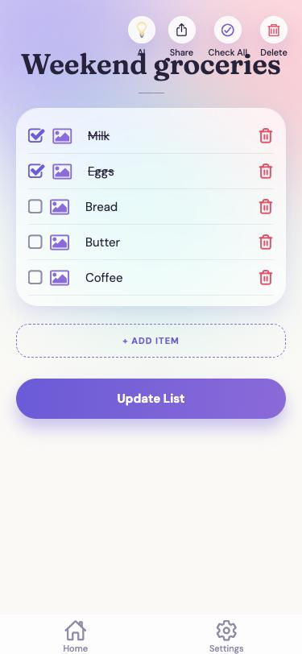
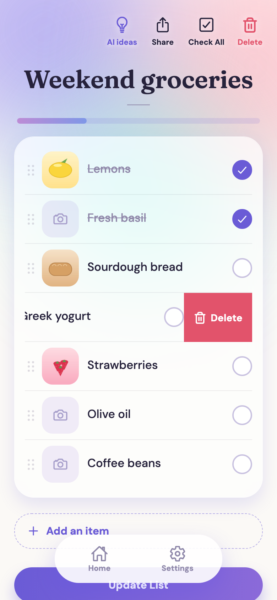
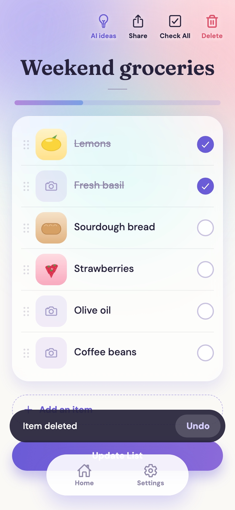
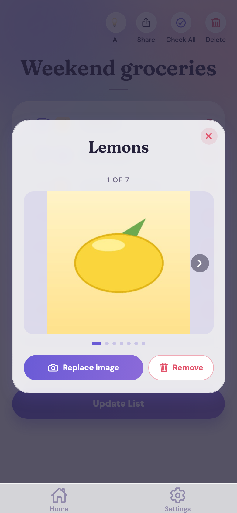
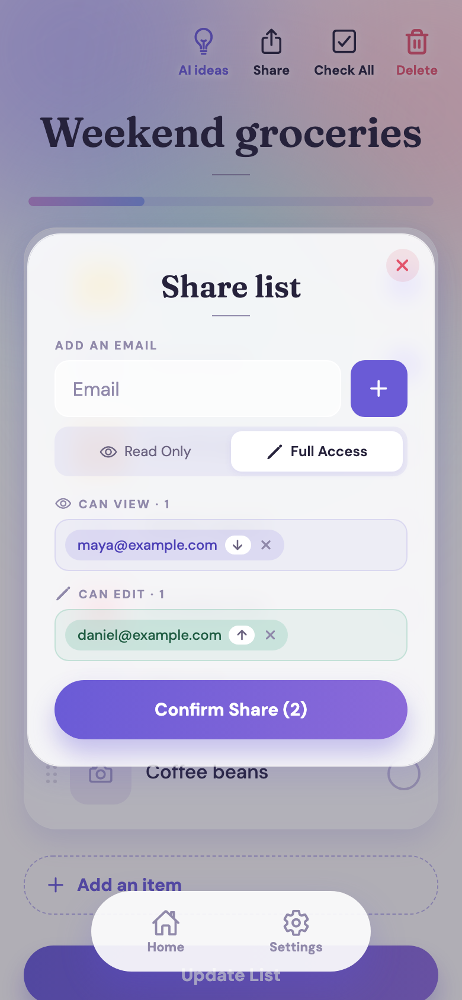
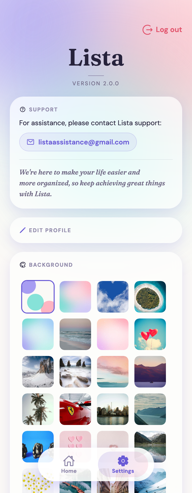
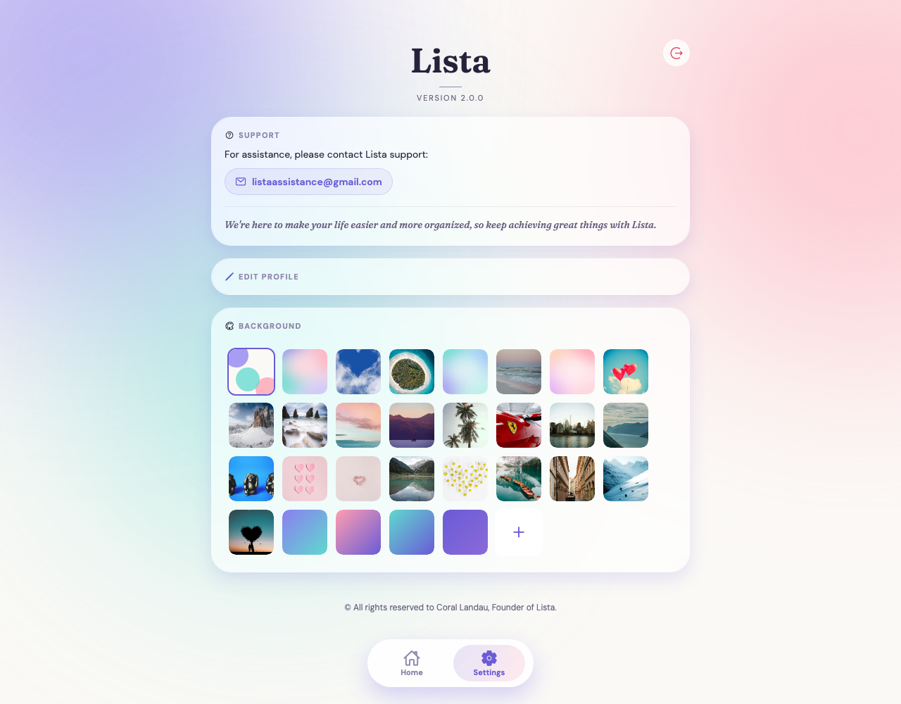
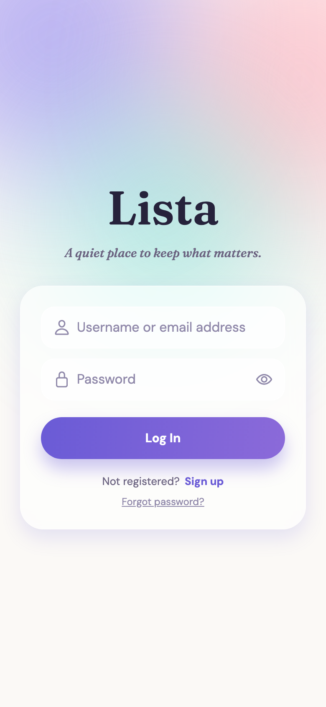
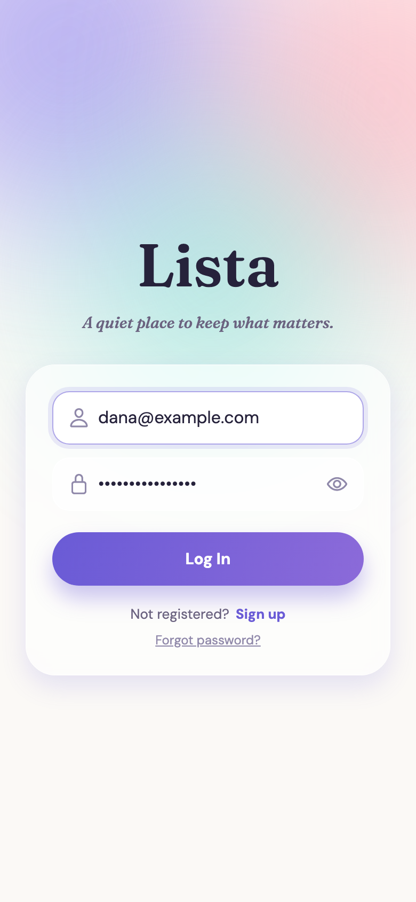
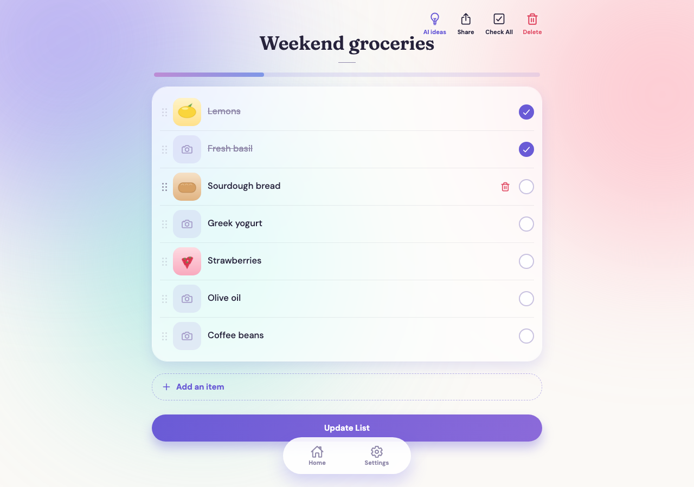

[← Back to the README](../README.md)

# Features and What Changed in Lista 2

**Legend:** ✅ already in Lista 1 &nbsp;·&nbsp; ⬆️ in Lista 1 and improved in Lista 2 &nbsp;·&nbsp; 🆕 new in Lista 2 &nbsp;·&nbsp; 🔁 changed in Lista 2

## All features

| | Feature | Status | In short |
|:-:|---|:-:|---|
| ✍️ | **Create and save lists** | ✅ | A title and as many items as you like, saved to your account |
| ☑️ | **Tick items off** | ✅ | Mark items as done |
| ☑️ | **Check All / Uncheck All** | 🆕 | Tick or clear a whole list in one tap, so a list is easy to reuse |
| 🏠 | **Home with your lists** | 🔁 | Your lists and a "Hello, <username>" greeting. Logout now lives in Settings only |
| 📊 | **Progress on every list** | 🆕 | A badge (`2/7`) and a colored bar on each Home card, and a progress bar at the top of every list |
| 🗑️ | **Update and delete lists** | ⬆️ | Deleted lists are only hidden. Now Lista asks first and warns when the list is shared. Deleting one item is a swipe, with Undo |
| 🖼️ | **Pictures on any row** | ⬆️ | Attach a picture and open it. Now with swipe, replace and remove, safe all-or-nothing saving, and photos shrunk before upload |
| ↕️ | **Drag rows into order** | 🆕 | A faint six-dot handle; the row's picture moves with it. Press Enter to add a row |
| 👈 | **Swipe a row to delete it, with Undo** | 🆕 | Swipe left and tap Delete; "Item deleted · Undo" brings it back, with its picture, for 5 seconds. On a computer: trackpad swipe or the trash that appears on hover |
| ⏳ | **A page appears only when it is ready** | 🆕 | Three dots from the very first moment the app opens and on every page while it loads (only if the wait is noticeable), then the complete page at once, pictures included; if it cannot load, a clear message and Try again |
| 🤝 | **Share with permissions** | ⬆️ | Read-Only or Full Access. Now several people at once, grouped by permission, enforced by the server, with truly view-only lists |
| 💡 | **AI ideas** | ⬆️ | Suggestions for your list. Now from Google Gemini, with tick-and-add, "New ideas" and friendly error states |
| 🎨 | **Backgrounds** | ⬆️ | Photos saved per person. Now also gradients and your own picture, on every page after you log in and scaled to any screen. A newly chosen background replaces the old one only once it has fully loaded |
| 🚪 | **Opening the app** | ⬆️ | Lista 1 opened on a Welcome page that asked people to wait for the free-tier server to wake up before using the app. Lista 2 opens straight on Login |
| 👤 | **Sign-up and login** | ⬆️ | Sign up with just a username, an email and a password, and log in with either your username or your email address; the session renews automatically |
| 🔑 | **Password reset by email** | ⬆️ | Now a single-use link that expires after one hour |
| ⚙️ | **Edit profile and Settings** | ⬆️ | Username and email only, and your profile is private. Settings keeps the support contact (now a tidier card with a tappable email), and on large screens stays in one centered column |
| 📱 | **Phone, tablet and desktop** | ⬆️ | Adapts to every size, including landscape and iPhone, and can be added to the home screen with its own icon |
| 💬 | **Messages after every action** | ⬆️ | Short, specific messages that say what happened and what to do next |
| 🫙 | **Empty-list messages** | 🆕 | A friendly "No items yet" on Home, in the list and in the AI box |
| ✨ | **Look and feel** | 🆕 | A complete redesign: soft gradients, frosted-glass cards, photo-first rows and a floating bottom bar |

## Lista 1 compared with Lista 2

Lista 1 already had lists, ticking items, pictures, sharing with permissions, backgrounds, AI ideas and password reset. 
Lista 2 keeps all of that and improves how it looks, feels and behaves.

| Area | Lista 1 | Lista 2 |
|------|---------|---------|
| **Look and feel** | Simple screens | A complete redesign: soft gradients, frosted-glass cards, elegant typography and a gentle loading animation |
| **Home** | Each list shows its title and its first items; a Logout button beside the greeting | Cards with a progress badge and bar for every list; Logout only in Settings |
| **Loading** | A small loader on an empty page, then everything pops in | Only the three dots, from the moment the app opens, until the whole page and its pictures are ready, then the complete page; a clear message and **Try again** if it cannot load |
| **List rows** | Handle, checkbox and trash on every row, text in one line that could slide sideways | Photo first, text that wraps inside the row, the checkbox on the right, a faint handle, all in one soft card; a progress bar on top |
| **Deleting one item** | A trash button on every row | **Swipe left** and tap Delete, with an **Undo** message for 5 seconds (no question asked); on a computer, a two-finger swipe or the trash on hover |
| **Bottom bar** | A full-width white strip | A floating pill with a soft highlight on the current tab |
| **Text fields** | The browser's blue box when focused | A soft violet frame with a faint halo |
| **Ticking items** | Tick one by one | Also **Check All / Uncheck All** |
| **Pictures** | Attach a picture and view it larger | A viewer with swipe, replace and remove; pictures saved together with the list in one safe step; large photos shrunk before upload; a row can hold just a picture |
| **Arranging rows** | Type in order | **Drag rows** by a faint handle, or press Enter to add a row |
| **Sharing** | One email at a time | **Several people at once**, grouped by permission, with clear messages for people who are not on Lista yet; Read-Only lists are truly view-only |
| **Deleting** | Deleted straight away | Asks first, and warns when the list is shared |
| **Messages** | General notices | Short, specific messages after every action that say what happened and what to do next |
| **AI ideas** | Suggestions from OpenAI | Suggestions from **Google Gemini**; tick ideas and add them, ask for new ones, and friendly messages when something goes wrong |
| **Backgrounds** | Photo backgrounds | Photos, **gradients** and **your own picture**, shown on **every page after you log in** and scaled to any screen |
| **Screen sizes** | Mainly phone-sized | Adapts to phones, tablets and desktops, including landscape, and works smoothly on iPhone |
| **Empty lists** | Blank | A friendly "No items yet" on Home, in the list and in the AI box |
| **Sign-up** | Username, first name, last name, email and password | **Just username, email and password** |
| **Opening the app** | A Welcome page that asked people to wait for the free-tier server to wake up before using the app | Opens straight on Login, so there is no waiting step |
| **Accounts and sessions** | Login with a username | Log in with a **username or an email address**; the session renews automatically, your profile is private, passwords must be strong, and reset links work once and expire |

## Feature guide

### ✍️ Create, save and reuse your lists
- Make a list in seconds: a title and as many items as you like. Everything is saved to your account, so your lists are there on every device.  
- **Tick items off** as you go, or use **Check All / Uncheck All**. Uncheck everything to reuse a list next week.  
- **Progress at a glance**: every list on Home is a card with a badge (`2/7`) and a colored bar, and every list has a progress bar at the top.  
- **Pictures**: attach a picture to any row. Tap it to open the viewer: swipe between pictures, replace or remove one.  
- **Organize by dragging**: pick a row up by its faint six-dot handle and drop it where it belongs; its picture moves with it. Press **Enter** to add a row right below. Long text wraps inside its row.  
- **Delete safely**: deleting a whole list asks first and warns when it is shared (lists are hidden, never erased). Deleting one item is a swipe to the left, followed by **Undo** for 5 seconds; nothing is saved until you press **Update List**.  

  
  
  
  

### 🤝 Share with the right permissions
- Share a list with **several people at once**, each as **Read-Only** (can view) or **Full Access** (can edit).  
- People are grouped by what they can do, and you can move them between groups before you confirm.  
- Read-Only members get a clean, view-only list, and the server enforces it too.  
- Someone who is not on Lista yet? You get a clear message to invite them, and everyone else is still shared.

  

### 💡 Get ideas when you run out
Tap the lightbulb for **five related ideas** for your list. **Tick the ones you like** and add them in one tap, or ask for **New ideas**. See [AI Suggestions](#ai-suggestions).

### 🎨 Make it yours
- Choose a **background** from beautiful photos and gradients, or **use your own picture**. It appears on every page after you log in, and a new choice replaces the old background only once its picture has fully loaded.  
- Update your profile, and log out with one tap.

  

On a large screen, Settings stays in one centered column and the backgrounds wrap across it:

  

### 🔒 Safe and always with you
- **Sign up in seconds** with just a username, an email and a password. Your account is private, and a password-reset link sent by email works only once.  
- **Log in with a username or an email address**: type either in the first field. Either way, Home greets you by your username.  
- The login renews itself quietly, so you are not thrown out in the middle of a list.  
- Works on phone, tablet and desktop, and can be added to a phone's home screen with its own icon.

  
  

  

### Also in Lista 2

- **Device compatibility:** the app ships with a web manifest, a favicon set and an Apple touch icon, so it has its own icon and theme color when added to a home screen.
- **Screens:** Login and Register (with a show/hide password toggle), Forgot password and Change password (from the emailed link), Home, the list screen with its AI, Share, Check All and Delete icons, and Settings (support contact, Edit Profile and the background gallery, which loads completely before it is shown).

### Not in Lista 1 or Lista 2 (yet)

Lista 1's README promised real-time updates, categories and deadlines, and automatic AI organizing. These were never built and are on the [roadmap](roadmap.md), not listed as features.

### Password rules

When the password is too weak, Lista says exactly what to change.

  

